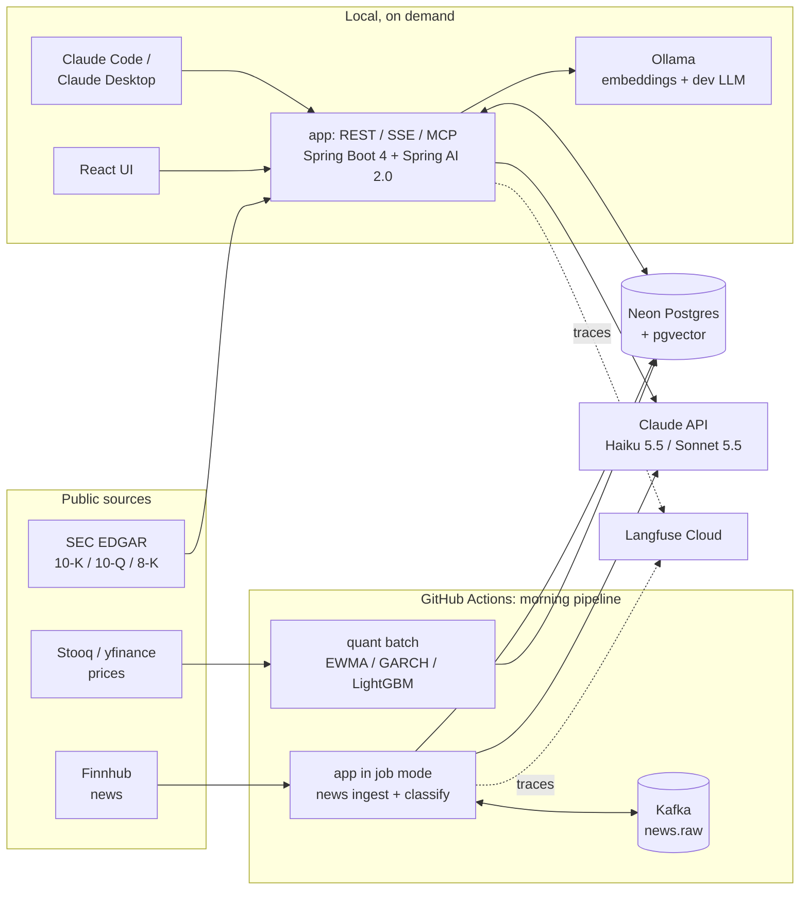
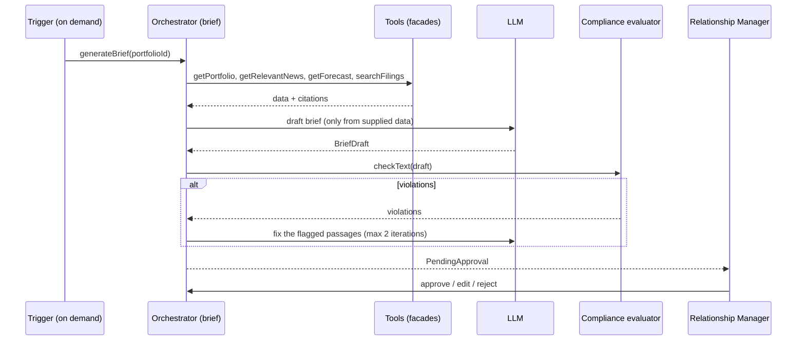

# Briefwise — Project Design

> AI copilot for Relationship Managers in private banking.
> Read this when you question an architectural decision or write the README.
> Last updated: 2026-10-16.

---

## 1. Elevator pitch

**Briefwise** is an AI copilot for private banking Relationship Managers. Every morning it scans client portfolios, classifies relevant news with an LLM, forecasts volatility and VaR with a backtested quant model, answers "why is X down?" questions with cited evidence from SEC filings, and drafts a compliance-checked client commentary that the RM approves before anything leaves the bank. Built with Java 25, Spring Boot 4, Spring AI 2.0, Kafka, PostgreSQL + pgvector and a Python quant pipeline, with evaluation suites gating every merge — and running for under 5 CHF a month.

Short version (CV, LinkedIn): *Every number has a source, nothing reaches a client without human approval.*

---

## 2. Problem

A Relationship Manager looks after 30–80 clients. Every morning they need to answer three questions:

1. **What changed** in my clients' portfolios since yesterday?
2. **What matters** — what could realistically affect risk or performance?
3. **What do I tell the client** who calls and asks "why is my Nvidia down?"

Today this is manual: a news terminal, risk reports from a separate system, personal notes. Information is scattered and client commentary is written from scratch. On top of that, every sentence sent to a client is subject to compliance rules (no recommendations without a suitability assessment, no performance promises).

**Briefwise aims to cut the morning review from ~60 to ~10 minutes** while keeping a human in control of everything that reaches a client. (This is a product hypothesis, not a measured result. The writeup must present it as a goal, not a fact.)

---

## 3. Persona and scenario

**Persona:** Claire, RM at a bank in Geneva, 45 clients, portfolios ranging from conservative to growth. She is not a quant, but she understands volatility, VaR and asset allocation.

**A day with Briefwise (product vision):**

| Time | What happens | Feature |
|---|---|---|
| 05:30 | Morning pipeline recalculates volatility and VaR forecasts for all instruments | `risk` (quant) |
| 05:40 | Pipeline fetches news for held positions, deduplicates and classifies it with an LLM | `news` |
| 07:15 | Agent assembles a morning brief per portfolio; compliance evaluator checks the text | `brief` + `compliance` |
| 07:30 | Claire opens the dashboard: 3 risk alerts, 7 relevant news items, 12 briefs to review | UI |
| 07:40 | She asks: "Why did Nvidia drop 6%?" and gets an answer citing the 8-K and news | `research` (RAG) |
| 07:50 | She edits one paragraph and approves the brief for client Dupont | human-in-the-loop |

In the portfolio deployment the pipeline steps run in GitHub Actions and briefs are generated on demand (see sections 13 and 14).

---

## 4. Scope

### In scope
- 3–5 **synthetic** portfolios (conservative, balanced, growth, optionally ESG and income), ~30 US companies and a few ETFs.
- News, filings and prices from **public sources** only.
- Full cycle: ingest → classification → risk → RAG → brief → compliance → approval.
- Evaluations for every AI feature, security tests, governance documentation.
- CI/CD and a daily automated pipeline.

### Out of scope (deliberately)
- **No order execution** and no automated actions on portfolios.
- **No investment recommendations.** The system describes and explains; it does not advise.
- **No real client data** and no code or data from any employer.
- **No automatic sending** to clients. Every text is approved by an RM.
- **No always-on public deployment.** Demo = video + local demo profile.
- Model fine-tuning, intraday trading, derivatives.

---

## 5. Features and milestones

| Milestone | Feature | AI and engineering concepts |
|---|---|---|
| **M0** (F1) | Skeleton: bounded contexts, synthetic portfolios, market data, CI | DDD + hexagonal, ArchUnit, Flyway, structured logging, correlation ID, Docker Compose, Kafka (KRaft), **CI from the first commit**, Claude Code skills |
| **M1** (F2) | News pipeline: ingest via Kafka, deduplication, LLM classification, daily portfolio summary, daily scheduled pipeline | System prompt, **structured output** to records, **few-shot**, **temperature / effort**, **token budgeting**, generation log with `prompt_version`, **resilience + fallback**, code gate before the LLM, tool calling, prompt caching, **transactional outbox**, idempotent consumer, DLT, **execution modes**, **replay provider**, **classification eval** |
| **M2** (F3) | Q&A "why is X down?" over SEC filings and news, with citations | **Embeddings**, **pgvector + HNSW**, **cosine similarity**, RAG (vector baseline → hybrid), chunking long documents, reranking, metadata filtering, query rewriting, **hallucination control**, **SSE streaming**, **RAG eval** |
| **M3** (F4) | Volatility and VaR forecast, risk alerts, backtest | Feature engineering, walk-forward validation, GARCH vs ML, leakage, MLflow |
| **M4** (F5) | Morning brief agent, approval workflow, own MCP server | Workflow vs agent, orchestrator-workers, evaluator-optimizer, **two-layer guardrail**, human-in-the-loop, authentication and roles, MCP, **trajectory eval** |
| **M5** (F6) | Red-team, guardrails, model card, risk assessment | Indirect prompt injection, tool abuse, output validation, FINMA 08/2024, EU AI Act |
| **M6** (F7) | Hardened daily pipeline, eval gating in CI, observability, demo | Eval gating, LLM tracing, prompt versioning, drift monitoring, cost dashboard |

Bold concepts are the foundations of a production LLM application. Each one must be visible in code and described in the README — they are what shows the system is built properly, not a one-prompt demo.

---

## 6. Architecture

### 6.1 Overview



Locally, `docker compose` provides Postgres + pgvector, Kafka and Ollama, so the full stack also runs offline.

**Key decisions:**

- **Modular monolith in Java** with bounded contexts (DDD + hexagonal, facades, ArchUnit). Not microservices — this is a one-person project.
- **Quant as a separate Python batch**, communicating only through the database. Java never calls Python synchronously. This is how overnight risk calculations work in banks, and it keeps two runtimes off the request path.
- **The Java–Python contract is the `risk_forecasts` table.** The schema belongs to the Java app (Flyway). Python only writes rows and never changes the schema.
- **Kafka for news ingest (`news.raw`)**, fed by a transactional outbox. Postgres is the source of truth; Kafka can be ephemeral (see 7.1).
- **One application, several inbound adapters**: REST/SSE, MCP server, in-app scheduler and a job runner. All of them call the same facades. The MCP server contains no logic, so the agent in the app, Claude Code and Claude Desktop see the same tools.
- **One database** (Postgres + pgvector + full-text search). A second vector database would only add operational cost.
- **No always-on server.** Scheduled work runs in GitHub Actions against Neon; the app and UI run locally when needed (section 14).

### 6.2 Bounded contexts

```
app/src/main/java/com/briefwise/
├── portfolio/     # Synthetic clients, portfolios, positions, risk profile
├── market/        # Instruments, prices, returns (market data reads)
├── news/          # Ingest, deduplication, outbox, Kafka, LLM classification, summaries
├── research/      # SEC filings: ETL, chunking, embeddings, hybrid search, cited Q&A
├── risk/          # Reads quant forecasts, alert rules
├── brief/         # Morning brief agent, commentary drafts, approval workflow
├── compliance/    # Guardrails: text rules, injection screening, approval audit
├── aiops/         # Generation log, cost and tokens, budgets, prompt versions, replay
├── access/        # Users (RM, ADMIN), JWT authentication
├── jobs/          # Inbound adapters: job runner, scheduler, admin "run now" endpoints
├── mcp/           # MCP server (inbound adapter over facades)
└── shared/        # Shared kernel: value objects, domain events, exceptions
```

Structure inside each context:

```
{context}/
├── domain/             # Pure domain — no Spring, JPA or external libraries
│   ├── model/          # Entities, aggregates, value objects (records)
│   ├── port/           # Interfaces: inbound (use cases) + outbound (repositories, AI, messaging)
│   └── event/          # Domain events (records)
├── application/        # Orchestration; {Feature}Service is package-private
├── infrastructure/     # Adapters
│   ├── persistence/    # JPA entities, repositories, MapStruct mappers
│   ├── messaging/      # Kafka producers/consumers, outbox relay
│   ├── ai/             # Spring AI adapters (ChatClient, EmbeddingModel)
│   └── web/            # REST/SSE controllers, request/response records
└── {Context}Facade.java  # PUBLIC — the only class other contexts may import
```

ArchUnit rules (checked on every build): domain purity, no access to another context's internals bypassing its facade, application services package-private, only facades and ports public.

| Context | Responsibility | Facade (proposal) |
|---|---|---|
| `portfolio` | Synthetic clients, portfolios, positions, weights | `getPortfolio`, `listPortfolios`, `getHoldings` |
| `market` | Instruments, price history, returns | `getPriceHistory`, `getDailyMove` |
| `news` | News pipeline and classification | `ingest`, `classifyPending`, `getRelevantNews`, `summarizeForPortfolio` |
| `research` | RAG over filings | `ask`, `searchFilings`, `ingestFiling` |
| `risk` | Forecasts and alerts | `getForecast`, `getAlerts`, `evaluateAlerts` |
| `brief` | Brief and client commentary | `generateBrief`, `approve`, `reject`, `edit` |
| `compliance` | Text and input validation | `checkText`, `screenUntrustedContent` |
| `aiops` | AI observability, cost, token budgets, replay | `recordGeneration`, `ensureBudgetAvailable`, `checkAndRecordUsage`, `getCostSummary`, `findReplay`, `replay`, `isReplayed` |
| `access` | Users, roles, login | `authenticate`, `getCurrentUser` |

### 6.3 Domain model (sketch)

```java
// portfolio
public record ClientId(UUID value) {}
public record Portfolio(UUID id, ClientId clientId, RiskProfile profile, List<Position> positions) {}
public record Position(Ticker ticker, BigDecimal quantity, BigDecimal weight) {}
public enum RiskProfile { CONSERVATIVE, BALANCED, GROWTH }

// shared
public record Ticker(String symbol) {}
public record Money(BigDecimal amount, Currency currency) {}
public record Citation(SourceType type, String sourceId, String locator, String excerpt) {}
public record TokenCount(int promptTokens, int completionTokens) {}

// news
public record NewsItem(UUID id, String headline, String summary, String url,
                       Instant publishedAt, String source, Set<Ticker> tickers, NewsStatus status) {}
public enum NewsStatus { RECEIVED, CLASSIFIED, UNCLASSIFIED, SKIPPED }
public record NewsClassification(Sentiment sentiment, Relevance relevance, EventType eventType,
                                 Set<Ticker> tickers, String rationale, String promptVersion) {}
public enum Sentiment { NEGATIVE, NEUTRAL, POSITIVE }
public enum Relevance { LOW, MEDIUM, HIGH }
public enum EventType { EARNINGS, GUIDANCE, M_AND_A, REGULATORY, LITIGATION, MANAGEMENT, MACRO, PRODUCT, ANALYST, OTHER }

// research
public record Filing(UUID id, Ticker ticker, FilingType type, LocalDate filedAt, String accessionNo) {}
public record FilingChunk(UUID id, UUID filingId, String section, int ordinal, String text) {}
public record ResearchAnswer(String answer, List<Citation> citations, Confidence confidence) {}

// risk
public record RiskForecast(Ticker ticker, LocalDate asOf, int horizonDays,
                           double predictedVol, double var95, String modelName, String modelVersion) {}
public record RiskAlert(Ticker ticker, AlertType type, String explanation, LocalDate asOf) {}

// brief
public record MorningBrief(UUID id, UUID portfolioId, LocalDate date, BriefStatus status,
                           List<BriefSection> sections, List<Citation> citations, boolean isFallback) {}
public sealed interface BriefStatus permits Draft, ComplianceFailed, PendingApproval, Approved, Rejected {}

// compliance
public record ComplianceResult(boolean passed, List<Violation> violations) {}
public record Violation(RuleId rule, String offendingText, String explanation) {}
```

> **Domain Questions Log:** could `MorningBrief`, with its sections, citations and status history, become a God object? Candidate split: `BriefDraft` vs `ApprovedCommentary`.

### 6.4 Domain events and Kafka topics

```java
public record NewsIngested(UUID newsId, Ticker ticker, Instant occurredAt) {} // ticker = Kafka key (ADR 0011)
public record NewsClassified(UUID newsId, Relevance relevance, Instant occurredAt) {}
public record RiskForecastsPublished(LocalDate asOf, String modelVersion, Instant occurredAt) {}
public record RiskAlertRaised(Ticker ticker, AlertType type, Instant occurredAt) {}
public record BriefDrafted(UUID briefId, UUID portfolioId, Instant occurredAt) {}
public record BriefComplianceFailed(UUID briefId, List<RuleId> rules, Instant occurredAt) {}
public record BriefApproved(UUID briefId, String approvedBy, Instant occurredAt) {}
public record InjectionSuspected(UUID contentId, String source, List<String> rules, Instant occurredAt) {}
```

- **In-process events** go through `ApplicationEventPublisher`.
- **Kafka topics:**

| Topic | Key | Producer | Consumer | Notes |
|---|---|---|---|---|
| `news.raw` | ticker | outbox relay (`news`) | classification consumer (`news`) | Idempotent consumer keyed by `newsId` |
| `news.raw.DLT` | ticker | Spring Kafka error handler | none (inspected manually / replayed) | Poison messages after retries |

Further topics (e.g. `news.classified`) only when a second consumer actually needs them.

---

## 7. Main flows

### 7.1 News pipeline (M1)

```
Trigger: admin "run now" endpoint | in-app scheduler | job runner (GitHub Actions)
  → fetch news from Finnhub for tickers held in portfolios
  → deduplication: URL hash + headline similarity (pg_trgm baseline; embeddings only if the eval shows a need)
  → one transaction: persist NewsItem(status = RECEIVED) + outbox row
  → outbox relay → Kafka news.raw (key = ticker)
  → consumer (idempotent by newsId):
      → CODE GATE: ticker held, not a duplicate, daily token budget not exceeded
      → untrusted content screening (compliance.screenUntrustedContent)
      → classification with a cheap model → NewsClassification
        (native structured output, effort low + maxTokens, few-shot in the cached system prompt; ADR 0012)
      → LLM error after retry → status UNCLASSIFIED (fallback); the item stays in the feed
      → persist + generation log (prompt_version, tokens, cost) + NewsClassified event
      → poison message → news.raw.DLT
  → HIGH relevance → input to the morning brief
```

**Why the outbox:** in GitHub Actions Kafka lives only for the duration of the workflow run. Postgres is the source of truth: anything not yet consumed stays `RECEIVED` and the relay re-publishes pending outbox rows on the next run. Nothing is lost when the broker disappears. An item whose message ends in `news.raw.DLT` also stays `RECEIVED`; a sweep of old `RECEIVED` items picks it up again (shape decided in M1 slice 6). Relay, key and idempotency: [ADR 0011](decisions/0011-news-outbox-relay-key-and-idempotency.md).

**Job completion:** in job mode the runner publishes, consumes, and exits when consumer lag reaches 0 or after `max-duration`.

### 7.2 Morning pipeline and risk batch (M3)

```
GitHub Actions cron (weekdays, UTC) or workflow_dispatch
  → step 1, quant/: fetch prices, compute features (incl. sentiment from news_classifications)
  → models: EWMA (baseline), GARCH(1,1), LightGBM
  → write forecasts to risk_forecasts + model version
  → step 2, app in job mode: news ingest + classification (7.1)
  → step 3, app in job mode: risk.evaluateAlerts
     (e.g. forecast volatility > 1.5× 60-day average)
```

Cron in GitHub Actions is UTC and can be delayed. Schedule with a margin (e.g. `30 4 * * 1-5`) and never rely on minute precision.

### 7.3 Q&A with citations (M2)

```
RM question
  → query rewriting (expand: ticker, period, event type)
  → hybrid search: Postgres full-text + pgvector, filter by ticker and date
  → rerank top-k
  → answer generated ONLY from the supplied passages
  → validation: every claim has a Citation; no source → "I don't know"
```

Filing ingest (ETL, chunking, embeddings) is an on-demand operation run locally with Ollama embeddings. It is not part of the daily pipeline.

### 7.4 Morning brief (M4)



**Two-layer guardrail:**
- *Layer 1, in code:* a brief is regenerated only if a HIGH-relevance news item or a risk alert has appeared since the last version. Otherwise the previous version is returned. The LLM is never called without a reason.
- *Layer 2, in the prompt:* the model may only use data returned by tools, every claim needs a citation, and investment recommendations are forbidden (hard constraints, never softened into "suggestions").
- *Fallback:* if the LLM is unavailable, the brief is built from a template over raw data and flagged `isFallback = true`.

**Decision for F5:** is the brief a **workflow** (fixed sequence) or an **agent** (the LLM chooses tools)? Default proposal: a workflow with one agentic step ("investigate the causes of large moves"). Cheaper, predictable, easier to evaluate. The comparison goes into the README.

Briefs are generated **on demand** by default (`briefwise.jobs.brief.enabled=false` in the schedule). They use the more expensive model and are only useful when someone reads them.

---

## 8. AI and engineering decision points

Per the rule in CLAUDE.md, none of these is decided silently. Each one is settled by an evaluation or by a deliberate trade-off recorded in `docs/decisions/`.

| Decision | Options | Starting proposal | How to decide |
|---|---|---|---|
| News classification model | Claude Haiku 5.5 · Claude Sonnet 5.5 · local model in Ollama | Haiku 5.5 | F1 and cost per 1,000 news items (M1 eval) |
| Client commentary model | Sonnet 5.5 · Opus 5.5 | Sonnet 5.5 | LLM-as-judge quality score + manual sample |
| LLM provider per environment | `ollama` · `anthropic` · `replay` | local dev: `ollama`; evals and jobs: `anthropic`; CI and demo: `replay` | Cost vs fidelity; ADR 0002 |
| Embedding model | Ollama locally (e.g. nomic-embed-text) · OpenAI text-embedding-3-small · finance model (e.g. Voyage finance) | Ollama (zero cost) | recall@k on `rag_golden.json` — interesting experiment: general vs finance |
| Headline deduplication | URL hash only · + pg_trgm similarity · + embeddings | URL hash + pg_trgm | Duplicate rate on a labelled sample |
| Kafka producer strategy | Plain producer after commit · transactional outbox · Debezium CDC | Transactional outbox with a polling relay | Ephemeral broker in CI/jobs requires durability in Postgres |
| Filing chunking | Fixed size with overlap · by 10-K section (Item 1A, Item 7…) · hybrid | By section + size limit | recall@k and citation correctness |
| Retrieval | Vectors only · hybrid (BM25 + vectors) | Hybrid | recall@k, comparison in README |
| Reranking | None · cross-encoder · LLM as reranker | None → add in F3 | Recall/precision gain vs cost and latency |
| Temperature | 0 for classification · 0.3–0.5 for commentary | As listed; models without temperature (e.g. Haiku 5.5) use `effort` instead: `low` for classification ([ADR 0012](decisions/0012-news-classification-llm-call.md)) | Stability across runs |
| Brief: workflow vs agent | Fixed sequence · agent with tools · hybrid | Hybrid | Task success, cost, latency, trajectory eval |
| Agent framework | Spring AI · Embabel · LangGraph (comparison) | Spring AI | Comparison table after F5 |
| Resilience | Resilience4j · native `@Retryable` from Spring Framework 7 | Resilience4j | Decide at bootstrap; record in an ADR |
| Few-shot | None · 2–3 static examples · dynamically selected (similarity) | 3 static | F1 with and without; **examples never from the golden set** (otherwise eval leakage) |
| LLM observability | Langfuse Cloud · self-hosted Langfuse · Micrometer only | Langfuse Cloud (free tier) | Self-hosted Langfuse needs ClickHouse, Redis and S3 — not worth it here |
| MLflow storage | Local file store · backend in a separate Neon project + artifacts as GitHub release assets | Local during research; decide at F4 week 6 | Model size and how the job loads it |
| Runtime hosting | GitHub Actions + Neon · Oracle Always Free VM · paid VPS | GitHub Actions + Neon | Cost ≤ 5 CHF/month, no idle reclamation risk (section 14) |

Model names live in `application.yml`, never in code. New models will appear within nine months.

---

## 9. Data

| Source | What | Constraints |
|---|---|---|
| **Finnhub** (free) | Company news | Per-minute rate limit; personal-use licence — show headlines and links in the demo, not full articles |
| **Alpha Vantage** (free) | Vendor sentiment as an eval baseline | Very low daily limit on the free key — fetch once, store locally |
| **SEC EDGAR** | 10-K, 10-Q, 8-K | Requires a `User-Agent` header with contact info and respecting the per-second rate limit |
| **Stooq / yfinance** | Daily prices | Educational use only; cache locally, don't query on every run |
| **Synthetic portfolios** | Clients, positions, profiles | Generated by a script in `quant/` or seeded by Flyway; zero real data |

Check current free-tier limits before implementation. They change.

---

## 10. Evaluation strategy

Evaluations are the backbone of the project and the main talking point in interviews.

| Area | Dataset | Metrics | CI threshold (start) |
|---|---|---|---|
| News classification | `evals/sentiment_golden.csv` (258 golden rows: random + stratified company sample, see [ADR 0010](decisions/0010-golden-set-labelling.md)) | Macro F1, confusion matrix, cost per 1,000 | F1 drops by no more than 3 pp |
| RAG | `evals/rag_golden.json` (40–50 questions + expected sources) | recall@5, faithfulness, citation correctness | recall@5 ≥ agreed baseline |
| Brief | `evals/brief_cases/` (15–20 scenarios) | Task success, coverage of relevant events, compliance violations, **number grounding** | 0 ungrounded numbers |
| Agent | Same scenarios | Trajectory correctness (right tools), step count, cost, latency | Trajectory ≥ 90% |
| Security | `evals/redteam/` (news and filings with injected instructions) | Attack success rate | 0 successful attacks from the set |
| Quant | Walk-forward on historical data | QLIKE, MSE vs EWMA, Kupiec test for VaR | Model no worse than baseline |

**Number grounding** is a finance-specific rule: every number in a brief (percentage, price, VaR) must appear in data returned by tools. A deterministic validator checks this, not an LLM.

**LLM-as-judge calibration:** compare the judge's scores with your own on 30–50 examples. Without that, the judge is just another model you trust blindly.

**When evals run (cost control):**
- Deterministic evals (number grounding, structure, ArchUnit): every PR.
- LLM evals: manually (`workflow_dispatch`) or automatically when `prompts/**` or `evals/**` change; submitted through the Message Batches API.
- CI never calls a live LLM for unit or integration tests: it uses WireMock recordings and the `replay` provider.

---

## 11. Security and compliance

### Threat model

| Threat | Vector in this system | Mitigation |
|---|---|---|
| **Indirect prompt injection** | A news item or filing contains "Ignore previous instructions…" | Untrusted content in clearly delimited data blocks; screening before the LLM; LLM has no permission to act |
| **Tool abuse** | Agent calls tools outside the task scope | Per-step tool allowlist; read-only tools; call limit |
| **Data exfiltration** | Model puts portfolio data into a URL or outbound content | No tools that send data out; output validation |
| **Hallucinated numbers** | Brief reports a non-existent 12% drop | Number grounding validator (section 10) |
| **Recommendation language** | "The client should sell…" | Compliance rules (pattern list + LLM evaluator) + RM approval |
| **Secret leakage in CI** | API keys printed in logs or exposed to fork PRs | GitHub Secrets, no secrets on `pull_request` from forks, masked logs |
| **Cost abuse** | Runaway loop or uncapped calls | Daily token budget per feature + spend limit in the Anthropic Console |

### Compliance rules for texts (start)

1. No buy, sell or hold recommendations.
2. No price forecasts or performance promises.
3. Every factual claim has a citation.
4. A fixed disclaimer at the end of every commentary.
5. No text leaves the system without status `Approved`.

### Governance documents (M5)
- `MODEL_CARD.md` — purpose, data, limitations, evaluation results.
- `AI_RISK_ASSESSMENT.md` — in the spirit of FINMA Guidance 08/2024: AI system inventory, risk classification, data quality, explainability, human oversight, dependency on the LLM vendor.
- `SECURITY.md` — threat model, red-team results, known limitations.

---

## 12. Non-functional requirements

| Area | Requirement |
|---|---|
| Cost | **≤ 5 CHF per month in steady state** (infrastructure + LLM). Development bursts allowed within the daily token budget. See section 13 |
| Latency | News classification < 3 s; RAG answer < 10 s (streamed); brief < 60 s |
| Resilience | Every LLM and HTTP call behind circuit breaker + retry + time limiter + fallback; parameters in `application.yml` |
| Token budgeting | Explicit `maxTokens` on every call; system prompt ≤ 500 tokens; RAG max 5 passages; daily token budget per feature; exceeding it → `UsageLimitExceededException` → HTTP 429 (or job step marked skipped) |
| Storage | Neon free tier: 0.5 GB per project. Retention policy for `ai_generation_log` (section 13.6) |
| Access security | Spring Security + JWT (RS256), roles `RM` and `ADMIN`; brief approval records the approver's identity |
| Observability | Every LLM call in `ai_generation_log` (prompt_version, model, tokens, cost, latency); tracing via Micrometer/OpenTelemetry → Langfuse Cloud |
| Reproducibility | Prompt version, LLM model and quant model version stored with every result |

### 12.1 Engineering conventions

**LLM calls**
- Prompts in English; response language set in configuration.
- Output is always structured (`BeanOutputConverter` → record); never parse free text.
- Every call is recorded in `ai_generation_log`: prompt, response, model, `prompt_version`, tokens, cost, latency. Changing a prompt = bumping `PROMPT_VERSION`.
- After every call: `TokenCount` → `AiopsFacade.checkAndRecordUsage()`.
- Minimum data in prompts: no client-identifying data, synthetic identifiers only.
- Invalid response structure → retry → fallback with a flag.
- Stable prefix first (system prompt, few-shot, tool definitions), variable content last, so prompt caching can hit.

**Code**
- Records for value objects, events, DTOs and request/response types.
- JPA entities only in `infrastructure/persistence`; MapStruct mappers.
- Unchecked domain exceptions; `Optional` instead of `null` in domain and application layers.
- Flyway is the only source of the schema (`ddl-auto: validate`), UUID keys, `created_at` / `updated_at`.
- Controllers, schedulers, job runners and MCP tools only call facades; zero business logic.

**Tests** (functionality verified by tests, not manual `curl`)
- Domain: plain unit tests without Spring.
- Application services: Mockito `mock()` on ports.
- AI adapters: WireMock with recorded LLM responses (valid, malformed, timeout).
- Kafka: Testcontainers Kafka; idempotency and DLT covered.
- Facades: `@SpringBootTest` + Testcontainers (Postgres with pgvector).
- Architecture: `ArchitectureTest` (ArchUnit).
- `docs/api.http` per context: happy path, 404, 400.
- UI: typecheck + ESLint; Vitest + Testing Library for pure functions and compliance-relevant components; one
  Playwright smoke against `demo` ([ADR 0007](decisions/0007-ui-delivery-strategy.md)).

**Cross-cutting**
- Structured logs: human-readable locally, JSON in `cloud` and `job` profiles.
- Correlation ID (`X-Correlation-ID`) in MDC for every request, job run and LLM call.
- CORS and profiles in configuration.

**Profiles**

| Profile | Purpose |
|---|---|
| `local` | Docker Compose: Postgres + pgvector, Kafka, Ollama. Default for development |
| `cloud` | Neon database + Claude API (view accumulated real data locally) |
| `job` | Non-web runner (`spring.main.web-application-type=none`), used by GitHub Actions |
| `demo` | `replay` provider + seeded snapshot; no API keys needed |
| `test` | Testcontainers, WireMock, `replay` |

---

## 13. Cost control

The goal: the project must not cost money while nobody uses it. Order of impact, biggest first.

### 13.1 No always-on infrastructure
Scheduled work runs in GitHub Actions; the database is Neon (scales to zero); the app and UI run locally on demand. See section 14.

### 13.2 Execution modes (feature toggles)

The same use case is reachable through three inbound adapters. Configuration decides which ones exist.

```yaml
briefwise:
  execution:
    mode: on-demand            # on-demand | scheduled
  jobs:
    news-ingest:   { enabled: true,  cron: "0 */15 7-22 * * MON-FRI" }
    news-classify: { enabled: true }
    risk-alerts:   { enabled: true }
    brief:         { enabled: false }   # expensive model; on demand by default
  llm:
    provider: ollama           # ollama | anthropic | replay
    replay:
      on-miss: fail            # fail (CI, demo) | fallback (local)
```

```java
@ConfigurationProperties("briefwise")
public record BriefwiseProperties(Execution execution, Map<String, JobProperties> jobs, Llm llm) {}

@Configuration
@EnableScheduling
@ConditionalOnProperty(prefix = "briefwise.execution", name = "mode", havingValue = "scheduled")
class SchedulingConfig { /* @Scheduled methods call facades, guarded by jobs.<name>.enabled */ }
```

| Adapter | When | Notes |
|---|---|---|
| Admin endpoint `POST /api/admin/jobs/{job}/run` | Always (role `ADMIN`) | On demand from UI or `api.http` |
| In-app scheduler | Only `mode=scheduled` | For an always-on host, if one is ever used |
| Job runner (`job` profile) | GitHub Actions | `--briefwise.job=news-ingest`, runs and exits |

No feature-flag library (Unleash, FF4J) at this stage: `@ConfigurationProperties` is enough. Runtime toggles stored in the database only if a real need appears.

### 13.3 LLM providers and replay
- `ollama`: local development, zero cost (quality differs — never use it for evals).
- `anthropic`: evals, daily jobs, on-demand features. Every call is recorded in `ai_generation_log`.
- `replay`: a Spring AI `ChatClient` advisor that answers from recordings keyed by `hash(feature, model, prompt_version, normalized input)`: committed fixtures in `evals/replay/` first, then `ai_generation_log`, which doubles as a response cache. Replayed answers are not logged or billed; on a miss `on-miss: fail` defers the work and `fallback` calls the model ([ADR 0015](decisions/0015-replay-provider.md)). CI, the local demo and repeated dev runs cost nothing and are deterministic.

### 13.4 Cheap model, cached prefix, batches
- Classification on Claude Haiku 5.5; Sonnet 5.5 only for commentary.
- Prompt caching of the stable prefix (system prompt + few-shot + tool definitions). For Haiku 5.5 the minimum cacheable prefix is 512 tokens, so the ≤ 500-token system prompt plus few-shot examples crosses it. Verify with `cache_read_input_tokens` in the response.
- Message Batches API for evals and backfills (discounted, not latency sensitive; stacks with caching).
- Code gate before every LLM call (7.1) and regeneration gate for briefs (7.4).

### 13.5 Hard caps
- Daily token budget per feature in `aiops` (in-app).
- Monthly spend limit in the Anthropic Console (outside the app — the last line of defence).
- Neon free tier suspends compute when its monthly quota is used — no surprise bill.

### 13.6 Storage retention
`ai_generation_log` grows fastest. Full prompt and response for 30 days (configurable), after that only hash, metrics and `prompt_version`. Replay entries needed by CI and the demo are exported to `evals/replay/` fixtures and kept in the repo instead of the database.

### 13.7 Estimate

Prices checked 2026-10-16; re-check before relying on them.

| Item | Assumption | Monthly cost |
|---|---|---|
| News classification (Haiku 5.5: $0.10 / $0.50 per MTok) | ~150 items/day after the gate, ~1.2k input + 200 output tokens, 22 weekdays | < 1 USD |
| Briefs (Sonnet 5.5: $2 / $10 per MTok) | ~10k input + 2k output per brief, 5 portfolios, ~10 runs/month on demand | ~2 USD |
| Evals | Sentiment eval ~600 calls per run on Haiku, via Batch API | < 0.5 USD per run |
| Embeddings | Ollama locally | 0 |
| Database | Neon free tier | 0 |
| CI and daily pipeline | GitHub Actions free minutes (check current limits for private repos) | 0 |
| LLM observability | Langfuse Cloud free tier (check limits) | 0 |
| **Total** | | **~1–4 USD** |

Not included: the Claude Code subscription used for development.

---

## 14. Runtime, CI/CD and demo

### 14.1 Where things run

| Component | Development | Daily pipeline | Demo |
|---|---|---|---|
| App (Spring Boot) | Local | GitHub Actions, `job` profile | Local, `demo` profile |
| Postgres + pgvector | Docker Compose | Neon (free) | Docker Compose with seeded snapshot |
| Kafka | Docker Compose (KRaft, single node) | Service container in the workflow | Docker Compose |
| Quant (Python) | Local `uv run` / notebooks | GitHub Actions step | Precomputed forecasts in the snapshot |
| Ollama | Local | Not used | Not needed (replay) |
| UI | Local (Vite dev server, proxy to the app) | — | Served by the app image (same origin) |

Neon free tier: 100 CU-hours of compute per project per month, 0.5 GB storage per project, pgvector supported, compute suspends after 5 minutes idle. A separate Neon project can be used for MLflow so it doesn't share the 0.5 GB quota.

### 14.2 GitHub Actions workflows

| Workflow | Trigger | What it does |
|---|---|---|
| `ci.yml` | Every PR and push to `main` | Build, unit tests, ArchUnit, Testcontainers (Postgres + Kafka), deterministic evals, Python lint and tests for `quant/`, UI lint, typecheck, API types up to date, unit tests and build for `ui/` |
| `evals.yml` | `workflow_dispatch` + path filter `prompts/**`, `evals/**` | LLM evals via Batch API; posts the results table as a PR comment; thresholds from section 10 block the merge |
| `morning-pipeline.yml` | Cron on weekdays (UTC) + `workflow_dispatch`; schedule active only if repo variable `PIPELINE_ENABLED == 'true'` | Quant batch → news ingest + classification → risk alerts, against Neon; Kafka as a service container |
| `release.yml` | Tag `v*` | Build the app image, publish to GHCR, attach the jar and release notes |
| Dependabot | Weekly | Maven/Gradle, npm, pip/uv, GitHub Actions |

Rules: secrets only in GitHub Secrets (`ANTHROPIC_API_KEY`, `NEON_DATABASE_URL`, `FINNHUB_API_KEY`); workflows triggered from forks never receive secrets; failed pipeline runs notify by email (GitHub default). In public repositories scheduled workflows are disabled after 60 days without repository activity — keep that in mind after the project ends.

### 14.3 Demo
1. **2–3 minute video** in the README (the main artefact for recruiters).
2. **Local demo:** `docker compose --profile demo up` — seeded synthetic portfolios, precomputed forecasts, `replay` provider. No API keys, zero cost, deterministic.
3. **Optional live demo (decide in F7):** Oracle Always Free Ampere A1 (currently 2 OCPU, 12 GB RAM). Risks: limited capacity, idle reclamation, terms that changed without notice in 2026. Access only via Tailscale, never public.

---

## 15. UI design

### Screens

Each screen ships in the milestone of the backend feature it shows (thin vertical slices); milestones, serving per
profile, auth and testing are in [ADR 0007](decisions/0007-ui-delivery-strategy.md).

| Screen | Content |
|---|---|
| **Login** (M4) | Username + password; JWT in an httpOnly cookie, CSRF token; role-based navigation (Admin only for `ADMIN`) |
| **Dashboard** | Portfolio tiles (daily performance, alert count, relevant news count), list of briefs awaiting approval, last pipeline run status |
| **Portfolio** | Positions with a change heatmap, forecast vs realised volatility (chart), alerts |
| **News** | Feed with classification (sentiment, relevance, event type); LLM rationale expandable under the headline |
| **Research** | Streaming Q&A chat; clickable citations with the filing passage highlighted |
| **Brief** | Draft editor, list of compliance violations, Approve / Reject buttons, change history |
| **Admin** | "Run now" buttons per job, token usage vs budget, cost summary |
| **Evals** (optional) | Latest suite results vs the previous prompt version |

### Design system (proposal)

Aesthetic: **a calm, information-dense private banking terminal.** Trust and legible numbers, no flashiness.

- **Background:** `#0B1220` · **Surfaces:** `#111A2E` / `#18233D` / `#22304F`
- **Accent:** `#C9A227` (muted gold — private banking) · **Muted accent:** `#5C4A12`
- **Semantic:** up `#34D399` · down `#F87171` · warning `#FBBF24` · neutral `#94A3B8`
- **Text:** `#E6EAF2` · **Muted:** `#8A94AD` · **Dark:** `#2A3654`
- **Fonts:** `Inter` (UI) · `IBM Plex Mono` (numbers, tickers, amounts — tabular figures)

Principles:
- Dark mode by default, light mode as an option.
- Numbers always right-aligned, tabular figures, unit and currency next to every amount.
- Colour is never the only carrier of meaning: sentiment also has an icon or label.
- Every AI-generated text carries a visible "AI draft" marker and a link to its sources (EU AI Act, Art. 50 — transparency).
  The marker is never removed: draft states "AI draft, not reviewed"; `Approved` "AI-generated · reviewed and
  approved by {rm}, {date}"; `Rejected` "AI draft, rejected by {rm}"; `isFallback` "Built from a template (AI
  unavailable)". It covers news rationale, daily summary, research answers and briefs.
- Approve is disabled while any compliance violation is open (enforced by the backend; the UI reflects it).
- LLM output is untrusted and always rendered as text, never as HTML.
- Every screen has loading, empty and error states (the error shows the correlation ID), plus the domain states it
  can meet: `UNCLASSIFIED` news, RAG "I don't know", budget exceeded (HTTP 429), suspected injection, fallback brief.
- UI language: English.

---

## 16. Technology stack

| Layer | Technology |
|---|---|
| Language / runtime | Java 25 (LTS) |
| Framework | Spring Boot 4, Spring AI 2.0.x |
| Architecture | DDD + hexagonal, ArchUnit |
| Security | Spring Security, JWT (RS256), roles RM / ADMIN |
| Persistence | PostgreSQL 16+ with pgvector and pg_trgm, Flyway, MapStruct; Neon in the cloud |
| Messaging | Apache Kafka (KRaft), Spring Kafka, transactional outbox |
| Resilience | Resilience4j |
| Testing | JUnit 5, Mockito, Testcontainers (Postgres, Kafka), WireMock (LLM mocks), ArchUnit |
| Logging | Logback: JSON in `cloud`/`job` (LogstashEncoder), correlation ID in MDC |
| LLM | Claude API (Haiku 5.5 for classification, Sonnet 5.5 for commentary), Ollama locally |
| MCP | Spring AI MCP server (Streamable HTTP) |
| Quant | Python 3.12+, uv, pandas, arch, scikit-learn, LightGBM, MLflow |
| Frontend | React + TypeScript + Vite + Tailwind + Recharts + Zustand; types generated from OpenAPI (springdoc + openapi-typescript); Vitest + Testing Library, Playwright smoke ([ADR 0007](decisions/0007-ui-delivery-strategy.md)) |
| Evals | JUnit (deterministic) + promptfoo (LLM, red-team) |
| Observability | Micrometer / OpenTelemetry → Langfuse Cloud |
| CI/CD | GitHub Actions (CI, evals with thresholds, morning pipeline, releases to GHCR), Dependabot |
| Runtime | GitHub Actions + Neon; local Docker Compose |

Verify current GA versions at bootstrap; do not rely on the versions above being the latest.

---

## 17. Repository structure and Claude Code workflow

```
briefwise/
├── CLAUDE.md                   # Conventions and standing instructions (short, < ~150 lines)
├── README.md                   # Writeup: problem, architecture, eval results, costs
├── MODEL_CARD.md
├── AI_RISK_ASSESSMENT.md
├── SECURITY.md
├── docs/
│   ├── PLANNING.md             # Task tracker with checkboxes
│   ├── PROGRESS.md             # Session log
│   ├── DESIGN.md               # This document
│   └── decisions/              # ADRs: one decision = one file
├── app/                        # Spring Boot 4 + Spring AI
├── ui/                         # React
├── quant/                      # Python: volatility models, batch, portfolio generator
├── research/                   # Notebooks (F0, F4)
├── prompts/                    # Versioned prompt templates
├── evals/                      # Golden datasets, promptfoo configs, replay fixtures, reports
├── .github/workflows/          # ci, evals, morning-pipeline, release
├── .claude/
│   ├── skills/                 # Claude Code skills
│   ├── agents/                 # Subagents (later)
│   └── settings.json           # Hooks (later)
└── docker-compose.yml          # Profiles: default (local), demo
```

**Working with Claude Code**
- Standing instructions in CLAUDE.md: explain every AI concept that appears in code; nothing is committed without approval; every AI decision point is named with options and trade-offs; ask before adding a dependency; verify library versions instead of relying on memory.
- Session start checklist: phase, what was built last, today's task, open questions.
- Session end: update `docs/PROGRESS.md` and `docs/PLANNING.md`, add new domain doubts to the Domain Questions Log.
- **Short CLAUDE.md** (< ~150 lines): only rules that always apply. Details live in skills and `docs/`, loaded on demand.

**Skills (`.claude/skills/<name>/SKILL.md`)**

| Skill | When created | Purpose |
|---|---|---|
| `new-bounded-context` | M0 | Scaffold domain/application/infrastructure/Facade, keep ArchUnit green, facade test skeleton |
| `flyway-migration` | M0 | Naming, UUID keys, timestamps, `ddl-auto: validate`, Testcontainers check |
| `adr` | M0 | Next numbered ADR: context, options, decision, consequences |
| `session-wrap-up` | M0 | Update PROGRESS/PLANNING, list domain questions, propose commit message |
| `llm-adapter` | F2, after the first adapter is written by hand | Structured output, generation log, budget, resilience, replay, WireMock test |
| `kafka-consumer` | F2, after the first consumer | Idempotency, DLT, Testcontainers test, outbox conventions |
| `new-eval-case` | F2 | Add a labelled case without leaking into few-shot examples |
| `rag-eval` | F3 | Run recall@k / faithfulness and update the results table |

A skill is written only after the pattern has been implemented once by hand. A skill written before that encodes guesses.

---

## 18. Open questions

| Question | When to decide |
|---|---|
| Kafka producer: outbox polling relay vs Debezium? (starting proposal: polling relay) | Decided: polling relay ([ADR 0011](decisions/0011-news-outbox-relay-key-and-idempotency.md)) |
| Add European/Swiss (SMI) companies? News and filings are harder to get for free | F3 |
| Forecast horizon: 1 day vs 5 days? | Start of F4 |
| MLflow storage for the daily pipeline | F4, week 6 |
| Brief per portfolio or per client (a client may have several portfolios)? | Start of F5 |
| Optional live demo on Oracle Always Free? | F7 |
| Make the repository public — when? (affects GitHub Actions minutes and scheduled workflow behaviour) | Before M6 |
| Client-facing view (preview of approved commentary) in the UI? | F7 |

---

## Tech tags

```
#ai #llm #java #springboot #springai #kafka #rag #pgvector #agents #mcp #evals
#ai-security #prompt-injection #mlops #cicd #githubactions #quant #volatility #var
#garch #lightgbm #private-banking #wealth-management #finma #eu-ai-act
#hexagonal-architecture #ddd
```
